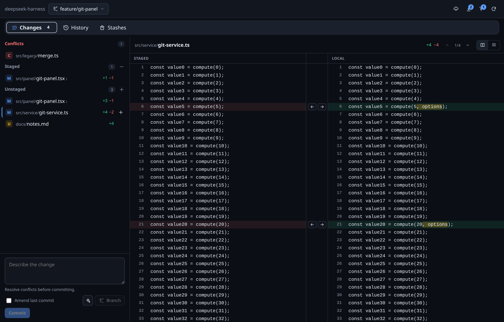
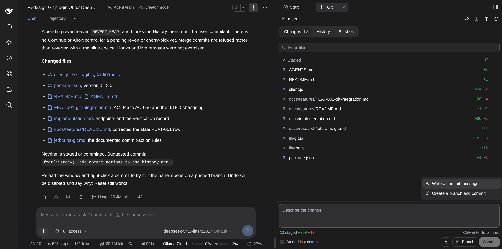
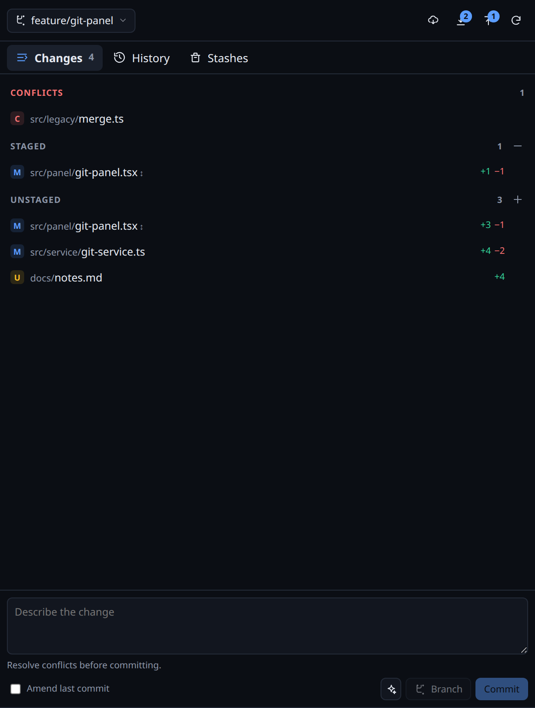
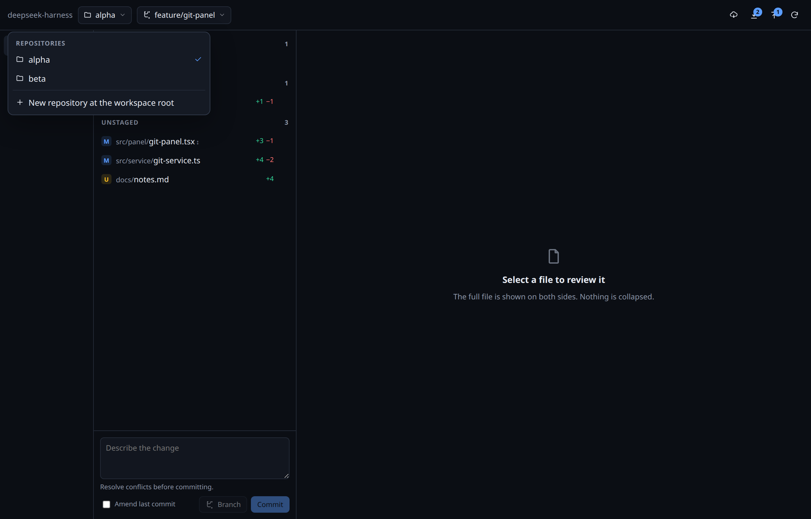
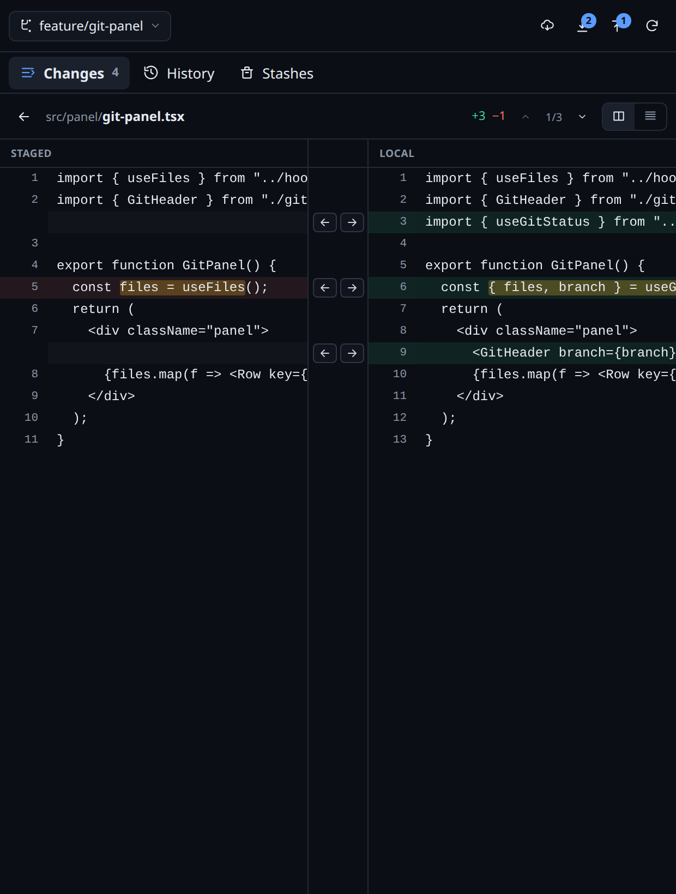
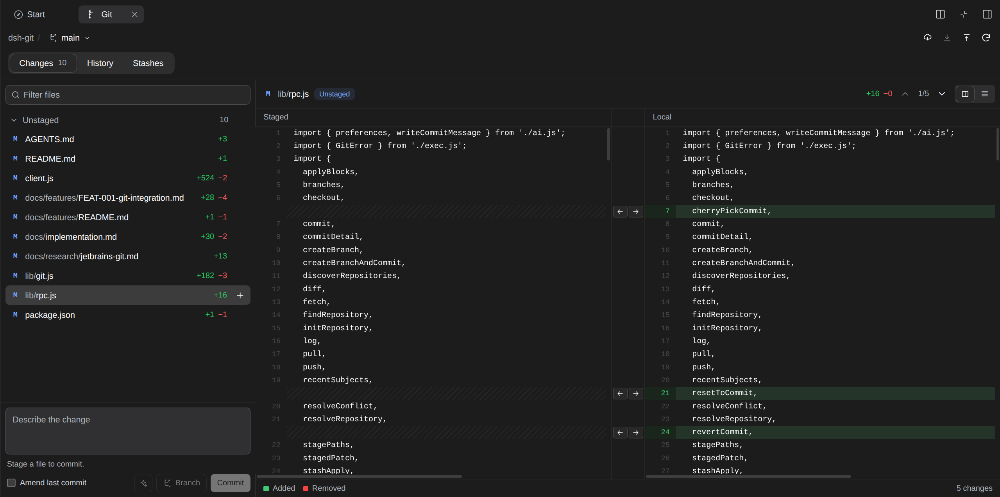

# Git desk for DeepSeek Harness

A Git tab in the Harness right sidebar. It opens on demand from the Start guide or tab strip, follows the session's workspace, and lists every repository under it, so a project with several repositories works without leaving the conversation. It shows full-file diffs, stages files and blocks, creates and switches branches, commits, syncs, stashes, and reads history.





## Install

The npm package name is `dsh-git-desk`. Add it to the current DSH profile with the plugin manager, then reload the window. For a local checkout, link this folder into the `web` profile as `dsh-git-desk` and reload.

## Open it

1. Reload the window once. In the desktop app, `Ctrl+R` reloads the current page. Use a hard reload if the old sidebar entry is still visible.
2. Open the Git tab from the **Git changes** card in the right sidebar Start guide, or use the add control in the tab strip.
3. Switch sessions and the tab follows the new session's workspace.

The tab is not a global panel. It does not sit above the Workspace session list.









## What it does

- **Repositories.** Every repository in the workspace is listed. The header picker scopes the whole panel, including its remote, branches, and sync. When the workspace has no repository, the panel offers to initialize one.
- **Changes.** Conflicts, Staged, and Unstaged groups. A file with both kinds appears in both groups with `↕`.
- **Bulk staging.** Each section header has one icon for the whole section. The plus stages every unstaged file, the minus unstages every staged file, both in a single request. The tooltip names the action. Conflicted files are excluded until they are resolved. A rename sends both of its paths, so the section empties completely.
- **Full-file diff.** Both sides show the entire file, line 1 to the last line. No unchanged runs are collapsed.
- **Change navigation.** The toolbar shows which change you are reading and how many the file has. The arrows jump to the previous or next change and keep both sides aligned.
- **Tooltips.** Every icon-only control shows a native tooltip with the same text as its accessible name, so the sync, layout, and staging icons read without guessing.
- **Two comparisons.** Staged compares `HEAD` to `Staged` with one arrow per block. Unstaged compares `Staged` to `Local` with two arrows per block.
- **Block actions.** Left arrow stages a local block. Right arrow in the unstaged diff reverts the block to the staged version after confirmation. Right arrow in the staged diff unstages the block.
- **Commit.** Message, amend toggle, and commit button. The button is disabled until something is staged and no conflict remains.
- **AI commit actions.** The sparkle button next to Commit offers two actions. **Write a commit message** reads the staged patch and fills the message field. **Create a branch and commit** generates the message, derives the branch name, and opens the branch dialog for confirmation. Both use the model selected in Settings and run only when you click them.
- **Branches.** The header menu searches local and remote branches, switches local branches, and creates a branch from `HEAD` without a commit. Choosing a remote branch creates a local tracking branch. The commit box still offers **Branch** for create-and-commit.
- **Branch and commit.** Creates a branch from the current `HEAD`, commits only the staged changes, and leaves Push as the next action.
- **Sync.** Fetch, pull, and push appear once in the header. Ahead and behind counts appear on push and pull only when they are not zero.
- **History.** Lanes, refs, author, relative time, commit detail, file list, and a read-only full-file diff preview in the right panel matching JetBrains ergonomics.
- **Commit actions.** Right-click a commit, or use the actions control in the detail header, to undo the last commit, revert it, cherry-pick it onto the current branch, or reset the branch to it. Undo and revert open Changes with the message filled and the changes staged. Undo is refused for a pushed HEAD, revert and cherry-pick are refused for merge commits, and every action is refused while another operation is in progress. The menu states the reason on the disabled row.
- **Stashes.** File-level stash with a message, then apply, pop, or drop.
- **Conflicts.** Marker view with `Accept ours` and `Accept theirs`. Commit is blocked until the conflict group is empty.
- **Layout.** Changes, History, and Stashes are horizontal segmented tabs above a consistent two-panel body: the navigator on the left and the preview on the right. Below 900 pixels the navigator and diff take turns at full width. The split diff stays the default, with the two arrows in the center gutter. The right pane is a preview at normal width; use the expand control for a full-width split, or switch to the unified diff.
- **Theme.** Every color uses native `--dsw-alias-*` or `--dsw-specific-*` design system tokens. Dark and light follow the host.

## Architecture

The client is a right-sidebar tab type. It registers a guide card, the tab body under `sidebar.right.pane.tab`, and the chip title under `sidebar.right.pane.tab.title`. The body resolves the current session's workspace and calls one authenticated Host channel, `/git-rpc`. The Host runs Git through `ctx.subprocess` with argv arrays and timeouts, and returns status and diff data. The client never runs Git.

Writes rebuild the exact index blob from the versions the diff came from, verify both side hashes, and reject a stale block. The full file is always read on both sides.

Commit messages can be written by the model selected in Settings. The Host sends the staged patch and the last five commit subjects to that provider only when the sparkle action runs. The message is cleaned to one `type(scope): summary` line before it reaches the field.

Both halves are TypeScript. `src/host/` compiles to `dist/`, which is the package entry, and `src/client/` is bundled into `client.js` in the harness module-loader format. The shapes the two halves exchange are in `src/contract.ts`.

```bash
npm install
npm run typecheck  # strict tsc over src/host and src/client
npm test           # host entry and route, bundle registration and first render
npm run build      # compile dist/ and rebuild client.js
```

The built output is committed, because the profile links this folder and the harness imports it without a build step. Edit `src/` and rebuild; never edit `dist/` or `client.js` by hand.

Details, endpoint table, and verification are in [`docs/implementation.md`](docs/implementation.md).

## Limits in this version

- The tab uses the current session's workspace path. A per-session `workingDirectory` override or a DSH worktree outside the workspace is not followed.
- Stash is file-level. Hunk-level stash is not implemented.
- Commit messages and branch names are not generated by a model.
- Conflict resolution is whole-side plus the marker view. There is no three-pane editor.
- Block arrows are hidden on a rename; use the file buttons.
- Symlinks, non-UTF-8 text files, and text files over 5 MB are treated as binary.
- Large diffs are not virtualized yet.

## Design package

The interactive mockup is still the design reference:

- [`mockup/index.html`](mockup/index.html) is a self-contained prototype with local fonts and no network calls.
- [`docs/design-brief.md`](docs/design-brief.md) records placement, layout, interactions, decisions, and open questions.
- [`docs/features/FEAT-001-git-integration.md`](docs/features/FEAT-001-git-integration.md) holds contracts, rules, acceptance criteria, and the implementation map.
- [`docs/research/jetbrains-git.md`](docs/research/jetbrains-git.md) and [`docs/research/vscode-and-gui-clients.md`](docs/research/vscode-and-gui-clients.md) hold the evidence notes.

The mockup palette approximates the harness theme. The plugin uses only host tokens.
