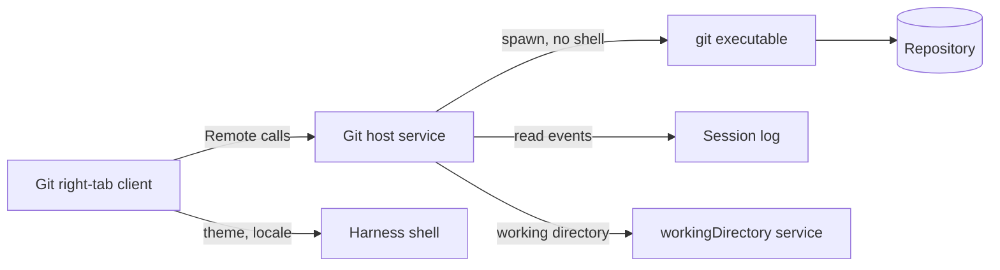
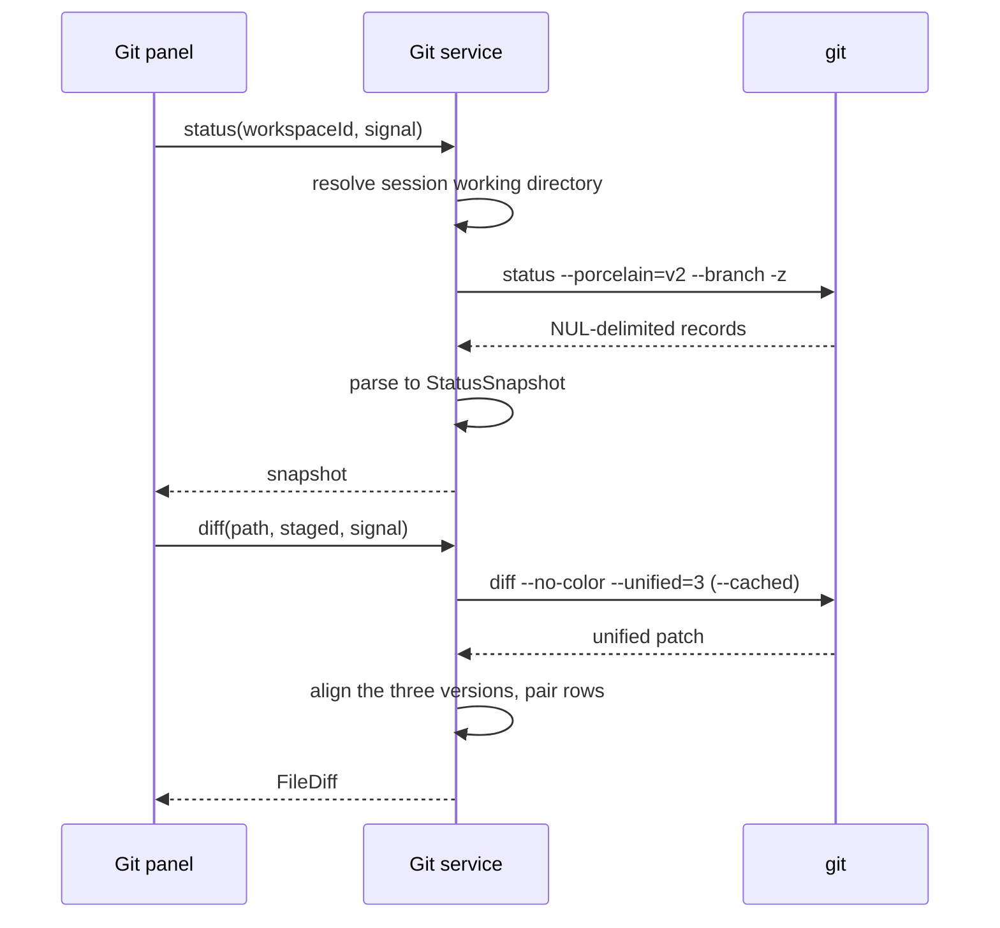
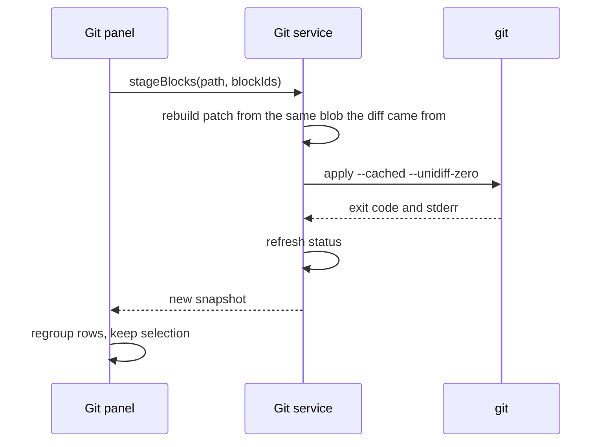

# Git integration

One sentence: a Git workspace inside DeepSeek Harness for reviewing, staging, committing, stashing, syncing, and reading history without leaving the conversation.

## 1. Snapshot

| Field | Value |
| --- | --- |
| Surface | Harness right sidebar tab, plus dialogs |
| Actors | Developer using the harness |
| Entry point | The Git button in the session header, or the **Git changes** card in the right sidebar Start guide |
| Primary outcome | Review the agent's diff, then commit or stash exactly what was chosen |
| State | Host and client implemented. Installed in the `web` profile. The client is a right-sidebar tab type and loads on the next window reload. History offers undo, revert, cherry-pick, and reset from a commit menu. Hunk stash, a three-pane merge, and history rewriting beyond those four actions are deferred. |
| Mockup | [`../../mockup/index.html`](../../mockup/index.html) |
| Implementation | [`../implementation.md`](../implementation.md) |
| Brief | [`../design-brief.md`](../design-brief.md) |

The host service, the authenticated HTTP channel, and the client panel exist. [`../implementation.md`](../implementation.md) records the implemented contract, the verification runs, and the remaining limits. Sections that still describe a target are marked.

## 2. Problem and outcome

A developer using the harness still keeps a JetBrains window open for Git. Reviewing an agent's change means finding the file in another application, and committing means reconstructing what the agent did from a diff viewer that does not know the session. The outcome we want is one window: the conversation, the changes, the diff, and the commit, with the session's working directory already known.

## 3. Scope

In scope for 0.6.0: status, file and block staging, commit, amend, file-level stash, fetch, pull, push, branch listing and checkout, commit log with graph metadata, commit detail, conflict detection and whole-side resolution.

0.18.0 adds four commit actions to History: undo the last commit, revert a commit, cherry-pick a commit, and reset the branch to a commit. Undo and revert return to Changes with the message filled, because that is where the panel already commits.

Out of scope for 0.6.0: hunk-level stash, a three-pane merge editor, model-written commit messages and branch names, submodules, worktrees UI, interactive rebase, per-line staging, blame, signed-commit setup, pull requests, multiple repositories in one panel, LFS, binary diff rendering, file-history view.

Out of scope for 0.18.0: drop commit, squash, fixup, edit commit message, tags, new branch at a commit, push all up to here, per-file revert, and revert of a merge commit. Each needs another dialog or a history rewrite the panel does not offer.

## 4. Terms

- Snapshot: one resolved view of repository state returned by the host.
- Every diff renders the full file, so a block is addressed by its line range, not by a window around a change.
- Block: one contiguous changed region in a file diff. The Unstaged diff is `Staged` to `Local`: the left arrow applies Local to Staged (stage), the right arrow applies Staged to Local (drop the local hunk). The Staged diff is `HEAD` to `Staged`: the right arrow applies HEAD to Staged (unstage). A block appears only in the diff where the two sides differ.
- Ahead and behind: commits local-only and remote-only relative to the upstream branch.

## 5. Actors

Developer. No other roles in v1.

## 6. User journey

1. The developer asks the agent to change code.
2. A badge on the panel rail shows the number of changed files.
3. The developer opens Git from the header button and sees Conflicts, Staged, and Unstaged groups.
4. They click a file and read a side-by-side diff of the entire file, with a center gutter, block arrows, and word-level highlights.
5. They press `+` to stage a whole file. In the unstaged diff, the left arrow stages one block; in the staged diff, the right arrow unstages one. The unstaged diff also has a right arrow that applies the staged side to local.
6. They write or generate a message and press Commit, or Commit and push.
7. If the branch should have a name, they press the branch button, accept or edit the generated name, and create the branch and commit. Push stays the next explicit action.
8. If the agent produced a conflict, the commit explains the conflict and the merge dialog resolves it.
9. They switch to Log to inspect what landed, or Stash to park work before another session.
10. They right-click a commit to undo the last one, revert it, cherry-pick it onto the branch, or reset the branch to it. Undo and revert open Changes with the message already filled.

## 7. System context



The client never runs Git. The host owns the process, the working directory, cancellation, and the parsed result.

## 8. Control flow

Read path:



Write path:



## 9. Data flow

- The working directory comes from the host `workingDirectory` service for the session, never from the client.
- Status and diff results are cached per session and invalidated by the host on every write and on a debounced filesystem watch.
- The client keeps only view state: selection and section, group collapse, diff layout, scroll position, draft message, and the branch draft. Block state comes from the host snapshot.
- The host returns the three file versions (`HEAD`, `Staged`, `Local`). The client aligns them for display and derives block ranges. The rendered diff is never a window around a change.
- Commit drafts are client state until commit. A draft must survive panel navigation in memory, not in the session log.
- No Git state is written into the session log. The repository is the source of truth.

## 10. Contracts

The browser-safe shapes are:

```ts
interface StatusSnapshot {
  repo: boolean
  root: string | null
  entries: StatusEntry[]
  branch: BranchInfo
  merging: boolean
  rebasing: boolean
  reverting: boolean
  cherryPicking: boolean
  conflicts: string[]
}

interface StatusEntry {
  path: string
  index: StatusCode
  worktree: StatusCode
  staged: boolean
  unstaged: boolean
  untracked: boolean
  conflicted: boolean
  both: boolean
  letter: StatusCode
  add: number | null
  del: number | null
  stagedAdd: number | null
  stagedDel: number | null
  binary: boolean
}

interface FileDiff {
  path: string
  side: 'staged' | 'unstaged' | 'log' | 'conflict'
  labels: { left: string; right: string }
  binary: boolean
  conflict: boolean
  left: string[]
  right: string[]
  rows: DiffRow[]
  blocks: DiffBlock[]
  add: number | null
  del: number | null
  baseHash: string
  targetHash: string
  leftMissing: boolean
  rightMissing: boolean
}

interface DiffRow {
  l: number | null
  r: number | null
  k: 'ctx' | 'mod' | 'add' | 'del'
}

interface DiffBlock {
  id: string
  leftStart: number
  leftEnd: number
  rightStart: number
  rightEnd: number
  kind: 'add' | 'del' | 'mod'
  row: number
}
```

The implemented wire contract is JSON over the authenticated `/git-rpc` channel. Every write returns a fresh status snapshot. The endpoint table in [`../implementation.md`](../implementation.md) is the exact list; the table below is the same shape:

| Endpoint | Input | Effect |
| --- | --- | --- |
| `status` | workspace | Read only |
| `init` | workspace | `git init` |
| `diff` | workspace, path, side, commit, parent | Full-file diff |
| `stage` | workspace, paths | `git add` |
| `unstage` | workspace, paths | `git restore --staged` |
| `discard` | workspace, paths, confirm | Restore tracked files to HEAD, delete untracked files |
| `applyBlocks` | workspace, path, side, blocks, hashes, confirm | Rebuild the index or working tree |
| `commit` | workspace, message, amend, noVerify | `git commit -F -`, with `--no-verify` when asked |
| `createBranchAndCommit` | workspace, name, message, noVerify | Create the branch, commit staged blocks |
| `push`, `pull`, `fetch` | workspace | Network, no force |
| `log` | workspace | Up to 100 commits |
| `commitDetail` | workspace, hash | Commit and files |
| `branches`, `checkout` | workspace, branch | Read and switch |
| `stashList`, `stashPush`, `stashApply`, `stashDrop` | workspace, ref, paths | File-level stash |
| `resolve` | workspace, path, side | Checkout one conflict side and stage it |
| `undoCommit` | workspace, hash | `git reset --soft` to the parent |
| `revertCommit` | workspace, hash | `git revert --no-commit` |
| `cherryPickCommit` | workspace, hash | `git cherry-pick` |
| `resetToCommit` | workspace, hash, mode, confirm | `git reset --soft`, `--mixed`, or `--hard` |

Every command runs with `LC_ALL=C`, `GIT_TERMINAL_PROMPT=0`, `GIT_OPTIONAL_LOCKS=0` where safe, and a timeout. No shell string is built.

## 11. Implementation map

| Path | Status | Responsibility |
| --- | --- | --- |
| `dsh-git/package.json` | Implemented | Bundle manifest, `dsh.client`, exports |
| `dsh-git/cordis.patch.yml` | Implemented | One host row, `dsh-git-desk` |
| `dsh-git/src/host/index.ts` | Implemented | Host entry and `/git-rpc` registration |
| `dsh-git/src/host/lib/exec.ts` | Implemented | Spawn, env, timeout, cancellation, filesystem reads for discovery |
| `dsh-git/src/host/lib/parse.ts` | Implemented | Porcelain v2, numstat, hunks, full-file rows, log, stash |
| `dsh-git/src/host/lib/git.ts` | Implemented | Repository discovery, status, diff, block writes, branch create and checkout, commit, file discard, sync, log, stash, conflicts |
| `dsh-git/src/host/lib/rpc.ts` | Implemented | Endpoint dispatch, repository validation, workspace resolution |
| `dsh-git/src/host/lib/http.ts` | Implemented | Authenticated JSON envelope |
| `dsh-git/client.js` | Implemented | Right-tab body and title, session header button, repository picker, session auto-open, branch menu and new-branch dialog, Start-guide card, compact and wide layouts, split and unified diff, dialogs, locales, styles |
| `dsh-git/locale/en.json`, `dsh-git/locale/zh.json` | Implemented | Plugin Manager metadata |
| `dsh-git/icon.svg` | Implemented | Plugin icon |
| `dsh-git/docs/implementation.md` | Implemented | Architecture, endpoints, verification, limits |

## 12. Business rules

- BR-001. Every write returns the new snapshot, and the client renders only from that snapshot.
- BR-002. A commit requires a non-empty message and at least one staged file.
- BR-003. An unresolved conflict blocks commit and says which file.
- BR-004. Push never uses force and never runs without a user action.
- BR-005. Pull defaults to fast-forward; merge and rebase are explicit choices.
- BR-006. Discard and delete operations require a confirmation that names the paths.
- BR-007. Block staging applies against the exact blob the block was read from. A stale blob fails the action and refreshes the diff.
- BR-008. Untracked files stage with `git add` and return to Untracked on unstage.
- BR-009. The stash message defaults to `WIP`; Git prefixes its own branch state.
- BR-010. No Git command runs with a shell, a user-formatted string, or an interactive prompt.
- BR-011. A file whose index and worktree both differ from HEAD appears in Staged and Unstaged with an `M↕` glyph.
- BR-012. A file appears in Staged when it has index blocks and in Unstaged when it has worktree blocks. Both is a valid state and shows `M↕`.
- BR-013. Committing a file with both index and worktree changes leaves its worktree blocks in Unstaged.
- BR-014. The Staged entry compares HEAD to Staged. The Unstaged entry compares Staged to Local. The two views are different comparisons of the same file.
- BR-015. Every diff renders the entire file. Unchanged lines are ordinary rows; no fragment is collapsed.
- BR-016. The Unstaged diff has two arrows per block. The left arrow applies Local to Staged; the right arrow applies Staged to Local. The Staged diff has one right arrow, which applies HEAD to Staged. A block is never shown in both diffs at once.
- BR-017. Creating a branch and committing requires a name, at least one staged file, and no unresolved conflict. It commits only staged blocks and does not push.
- BR-018. Push and pull controls and their counts appear once, in the header toolbar.
- BR-019. The right arrow in Unstaged drops local work. It requires a confirmation or an undo in production; the mockup applies it directly.
- BR-020. History actions run only with no merge, rebase, revert, or cherry-pick in progress. The host refuses the action and the menu says why.
- BR-021. Undo applies only to the HEAD commit of the current branch. The commit must have a parent, the branch must not be detached, and HEAD must not already be on the upstream branch. The reset is soft, so the change returns staged and the message is refilled in Changes.
- BR-022. Revert requires a clean index, because a revert mixes with whatever is already staged. It stages the inverse change and the message `Revert "<subject>"` with the `This reverts commit <hash>.` line, then opens Changes. The commit stays in history. A merge commit is refused. A conflicting revert stays pending in the working tree and is finished by a normal commit after resolution.
- BR-023. Cherry-pick refuses a merge commit, an unresolved conflict, and a commit whose patch is already applied to the branch. A successful pick commits immediately with the original message. A conflicting pick is aborted, so the branch and the working tree are unchanged.
- BR-024. Reset requires an explicit mode and a confirmation. Hard reset discards tracked changes and warns that it cannot be undone. A detached HEAD is refused.
- BR-025. Pull is fast-forward only even when the repository sets `pull.rebase`. When Git refuses the update because local changes are in the way, the working tree is stashed, the pull is retried, and the stash is popped with the index intact, so staged files stay staged. When an untracked file would be overwritten, every untracked file joins the stash so the pull can proceed; the whole stash is restored or kept. If the pop cannot apply cleanly, the pull stays applied, the stash is kept, and the client reports it.
- BR-026. Discard changes restores the named files to HEAD in the index and the working tree and removes them from Staged and Unstaged. The request names the exact selected entries; the host expands a rename by its recorded old path. An untracked file is deleted from disk, but an untracked nested repository is left in place and reported. Discarding a rename is refused when another unselected file occupies its old path. The host requires a confirmation, refuses a conflicted file, and refuses while a merge, rebase, revert, or cherry-pick is in progress. There is no local undo.
- BR-027. The commit box and the branch dialog offer Skip hooks. When it is checked, the host commits with `git commit --no-verify`; otherwise Git hooks run. The option defaults off, is not persisted, and applies to a normal commit, an amend, and a branch and commit. The host only skips hooks when the request asks for it.

## 13. Acceptance criteria

| ID | Criterion |
| --- | --- |
| AC-001 | Opening the Git tab from the right sidebar Start guide lists every changed file in the current session's workspace with status and add/delete counts, grouped Conflicts, Staged, and Unstaged. |
| AC-002 | Clicking a file renders the entire file side by side, line 1 through the last line, with left and right line numbers that match the two versions. No unchanged fragment is collapsed. |
| AC-003 | Pressing `+` stages every change in the file, updates the staged count, and renders its `HEAD` to `Staged` diff; pressing `−` moves every change back to Unstaged. |
| AC-004 | Clicking the left arrow on one block of the unstaged diff stages only that block. It leaves the unstaged diff and appears in the staged diff. Clicking the right arrow on another unstaged block applies the staged side to local and removes that local hunk. The two sections never repeat the same block. |
| AC-005 | Commit with an empty message or no staged file does nothing and explains why. |
| AC-006 | With an unresolved conflict, committing selects the conflicted file and explains that it blocks the commit. |
| AC-007 | Resolving the conflict stages the file, removes the conflict group, and allows the commit. |
| AC-008 | Commit includes only staged blocks. A file with unstaged blocks remains in Unstaged with those blocks; a fully staged file leaves the list. The commit is prepended to Log and ahead increments. |
| AC-009 | Commit and push commits, pushes, moves `origin/<branch>` to the new commit, and sets ahead to zero. |
| AC-010 | Push with nothing ahead is a no-op with a message; a rejected push shows the remote error and keeps ahead unchanged. |
| AC-011 | Pull fast-forwards, updates the working tree, and sets behind to zero. |
| AC-012 | Stash with three files and five blocks selected removes exactly those files, leaves the rest, and creates one stash whose message matches the name field. |
| AC-013 | The Log list renders lanes, refs, author, and time; selecting a commit shows its message, files, and a read-only full-file diff with parent and commit labels and no hunk arrows. |
| AC-014 | Checking out another branch updates the header, ahead and behind, and refreshes status. |
| AC-015 | Every screen follows the host theme in dark and light and uses only `--dsw-alias-*` and `--dsw-specific-*` colors, with tints derived from them. |
| AC-016 | Escape closes the top overlay and returns focus to the control that opened it. |
| AC-017 | Diff rendering a 5,000-line file does not block input for more than 100ms. |
| AC-018 | All visible strings come from the locale service; no string is hardcoded in a component. |
| AC-019 | The Unstaged entry shows `Staged` and `Local` with two arrows per block. The Staged entry shows `HEAD` and `Staged` with one arrow per block. No block appears in both entries. |
| AC-020 | The branch dialog generates a name from the message, creates the branch, commits only staged blocks, and leaves Push as the next action. It is disabled while a conflict is open or nothing is staged. |
| AC-021 | Fetch, pull, and push appear once. Ahead and behind counts appear only on the push and pull controls, not in the branch chip or the status bar. |
| AC-022 | Every icon-only control shows a native tooltip that matches its accessible name. No custom tooltip overlay and no new keyboard shortcut are introduced. |
| AC-023 | A workspace containing `alpha/` and `beta/` repositories lists both. Selecting `beta` scopes the branch chip, changes, log, stash, and sync to `beta`, and `alpha` files never appear. |
| AC-024 | A workspace with no repository shows Initialize. Initializing creates a repository at the workspace path and the panel loads it. |
| AC-025 | When repositories already exist, root initialization is offered only through a confirmation that warns the nested repositories become untracked folders. |
| AC-026 | New branch creates a branch from `HEAD` with nothing staged, checks it out, and updates the branch chip. |
| AC-027 | The branch menu searches local and remote branches. A remote branch checkout creates a local tracking branch, and the current branch is marked. |
| AC-028 | The Git tab opens only on explicit user request (from the session header button, the Start guide card, or the tab strip), and does not automatically open when a session starts. |
| AC-029 | A `repo` path that is relative, not a repository root, or outside the workspace is rejected by the host. The one exception is the repository that encloses the workspace, which is a valid repository for a workspace subdirectory. |
| AC-030 | The plus in the Unstaged header stages every unstaged file that is not conflicted in one request, sending both paths of a rename, and the Unstaged section disappears when nothing remains. Its tooltip reads `Stage all`. |
| AC-031 | The minus in the Staged header unstages every staged file in one request, and the files return to Unstaged with their local changes intact. Its tooltip reads `Unstage all`. |
| AC-032 | The diff toolbar shows the current change and the change count. The arrows move to the previous or next change and scroll both sides to it in split view, and the single pane in unified view. They are disabled when no change lies in that direction, and the count follows manual scrolling. |
| AC-033 | The sparkle menu offers **Write a commit message** and **Create a branch and commit**. With nothing staged both rows are disabled; with an unresolved conflict the branch row is disabled and the message row stays available. A failed model call shows its message in the error banner and leaves the field unchanged. |
| AC-034 | **Write a commit message** sends the staged patch and the last five commit subjects to the configured model, fills the message field with a cleaned `type(scope): summary` title and, when the model writes one, a short body, and never commits. **Create a branch and commit** fills the same message, derives the branch name from the title line only, and opens the branch dialog; the commit happens only after the user confirms. |
| AC-035 | The two-panel architecture is consistent across all modes: Panel 1 is the navigation/action area on the left (Changes lists / History commit list & details / Stash list) and Panel 2 is the full-height Diff Preview on the right. |
| AC-036 | In History mode, selecting a commit shows its commit metadata and changed files list in Panel 1, and automatically displays the full-height diff for the selected file in Panel 2. Root/orphan commits (where `parents[0]` is undefined) diff cleanly against an empty tree without throwing. |
| AC-037 | Every control and surface uses DSH native design tokens (`--dsw-*`): segmented tab capsule with `--dsw-alias-bg-module-platform`, elevated tab indicator with `--dsw-alias-bg-layer-3`, rounded control radii (`--dsw-radius-sm/md/lg`), and subtle hairline dividers (`--dsw-alias-border-l1/l2`). |
| AC-038 | ResizeObserver callbacks are wrapped in `requestAnimationFrame` to eliminate unhandled resize loop errors. Workspace and repository change handlers preserve active state to eliminate reload/reconnection flickers. |
| AC-039 | The session header shows a Git button next to the change request button. Pressing it opens the Git tab; pressing it while the tab is on screen collapses the right sidebar. It reports pressed state, names itself `Git panel` to assistive technology, and shows the same label as its tooltip. |
| AC-040 | While this plugin is installed, the session header does not show the built-in change request button, so only the Git button carries a branch glyph. The change request panel keeps its tab and opens from the tab strip. |
| AC-041 | Changes and History both draw a draggable divider between the list column and the diff column. Dragging it moves the split live, the file list keeps at least 220px, the diff keeps at least 280px, and the chosen width is stored in this browser under `dsh-git.split`. |
| AC-042 | The divider is a focusable separator: left and right arrows move it by 16px, Home resets it to 320px, and double-click resets it with the pointer. It names itself for assistive technology, reports its current and maximum width, and shows a focus ring. |
| AC-043 | The divider disappears in the stacked compact layout, where the columns take the full width in turn. It reappears when the panel is wide again. |
| AC-044 | Both views share one width, so switching between Changes and History does not move the split. When the panel narrows, the stored width is clamped so the divider the user sees is the one the next drag starts from. |
| AC-045 | The commit message field shows the whole message, title and body, without the user opening it. Its height follows the content, refits when the column changes width, and scrolls only when the message exceeds 45% of the panel height. It has no manual resize handle. The branch dialog field behaves the same. |
| AC-046 | Right-clicking a commit, or pressing the actions control in the detail header, opens a commit menu with Copy commit hash, Undo last commit, Revert commit, Cherry-pick commit, and Reset branch to here. An unavailable row is disabled and states the reason in the menu. Escape closes the menu and restores focus to the element that had it before the menu opened. |
| AC-047 | Undo last commit is enabled only for the HEAD commit of the current branch when it has a parent, the branch is attached, and HEAD is not on the upstream. Running it soft-resets to the parent, switches to Changes with the undone files staged, and fills the message with the undone message. A pushed commit, a root commit, and a detached HEAD are refused with their reason. |
| AC-048 | Revert commit stages the inverse change for a non-merge commit when the index is clean, fills `Revert "<subject>"` and the `This reverts commit <hash>.` line, and switches to Changes. Committing finishes the revert. A conflicted revert stays pending with the conflict group, and committing after resolution finishes it. A merge commit or a dirty index is refused. |
| AC-049 | Cherry-pick applies a non-merge commit that is not already applied and commits it on the current branch with the original message, then refreshes the log. On conflict the pick is aborted, the branch and working tree are unchanged, and the error names the conflicted paths. A merge commit, an applied commit, and an unresolved conflict are refused. |
| AC-050 | Reset branch to here opens a dialog with Soft, Mixed, and Hard, the target hash, and a confirmation. Soft leaves the changes staged, Mixed leaves them unstaged, and Hard discards them after a warning. The dialog reports a host error without closing. Detached HEAD is refused. |
| AC-051 | A pull with a local change to a file the update also changes stashes the change, fast-forwards, and restores it, keeping an already staged file staged. |
| AC-052 | A pull with a local change the update does not touch fast-forwards without creating a stash. |
| AC-053 | A pull with an untracked file that the update would overwrite completes, keeps the local file in the stash, and shows a notice that the restore was incomplete. |
| AC-054 | When restoring the stashed changes conflicts with the update, the pull stays applied, the panel switches to Changes, the conflict is shown, the stash is kept, and a notice that the status poll does not clear says the restore was incomplete. |
| AC-055 | A pull refused because the branches diverged leaves the working tree and the stash list unchanged. |
| AC-056 | Discard changes on a modified tracked file restores the HEAD content and removes the file from Staged and Unstaged. |
| AC-057 | Discard on a file with staged and unstaged changes clears both the index and the working tree. |
| AC-058 | Discard on a staged rename restores the old path and removes the new path. |
| AC-059 | Discard on an untracked file deletes it from disk, and a file name containing a literal wildcard character deletes only that file. |
| AC-060 | Discard requires an explicit confirmation; without it the host refuses and the file stays unchanged. |
| AC-061 | Discard in a repository with no commit removes the staged file from the index and from disk. |
| AC-062 | When the retried pull fails, the stashed local changes return to the working tree, the pull error is shown, and the temporary stash is gone. |
| AC-063 | When both the retried pull and the stash restore fail, the error says the changes remain in the stash and the stash keeps them. |
| AC-064 | When the stash mixes tracked and untracked changes, the tracked part returns to the working tree, the untracked collision keeps the whole stash, and the notice says the restore was incomplete. |
| AC-065 | A stash created while the pull runs is never popped; the pull reports that its own local changes remain in the stash. |
| AC-066 | Discard deletes a staged new file in a repository with a commit. |
| AC-067 | Discard is refused while a merge is in progress. |
| AC-068 | Discard does not delete an untracked nested repository; it reports the path and leaves the files alone. |
| AC-069 | Selecting an untracked path that reuses a rename's old path deletes only that file and leaves the rename staged. |
| AC-070 | Discarding a rename is refused when another file occupies its old path; both files stay untouched. |
| AC-071 | A failing pre-commit hook refuses a normal commit, shows the hook output, and leaves the message and staged files in place. |
| AC-072 | With Skip hooks checked, the commit succeeds through the failing hook and the resulting commit has the typed message. |
| AC-073 | Branch and commit passes Skip hooks through, so the branch is created and the commit lands despite the failing hook. |

## 14. Security and privacy

- SEC-001. Paths are resolved against the session working directory and rejected if they escape it.
- SEC-002. Commands are argument arrays. No user input is interpolated into a shell.
- SEC-003. Credentials are never read, logged, or stored. Authentication is delegated to the user's Git credential helper.
- SEC-004. Diff and commit content may contain secrets. It stays local and is never sent to a model unless the user explicitly asks for a message. The two AI commit actions do exactly that: they send the staged patch and the last five commit subjects to the provider selected in Settings, and nothing else.
- SEC-005. Push, pull, and branch checkout are the only network and state-moving operations, and each requires an explicit action.
- SEC-006. Discard deletes local work. The host requires `confirm: true`, the client names the file in the dialog, and discard is refused for a conflicted file or while a merge, rebase, revert, or cherry-pick is in progress.

## 15. Failure behavior

| Failure | Behavior |
| --- | --- |
| `git` missing | Panel shows "Git is not installed" with the searched path |
| Not a repository | Panel offers "Initialize repository"; no destructive default |
| Command timeout | Cancel the operation, show the command and timeout |
| Hook failure | Show hook stdout and stderr, keep the message and staged files; Skip hooks commits anyway |
| Stale block | Refresh the diff, explain that the file changed, do not silently retry |
| Permission denied | Show the path and the OS error |
| Pull restore conflict | The pull stays applied, the panel switches to Changes, the conflict group opens, the stash is kept, and a persistent notice says the restore was incomplete |
| Pull retry fails | The stashed changes return to the working tree, the temporary stash is dropped, and the pull error is shown |
| Pull retry and restore fail | The stash is kept, the error names it, and the changes stay in it |
| Pull mixed stash | The tracked part returns to the working tree, the untracked collision keeps the whole stash, and the notice says the restore was incomplete |
| Discard without confirmation | The host refuses with `git/confirm-required`; the confirmation dialog is the only caller |
| Discard a conflicted file | The host refuses; the conflict stays for the accept buttons |
| Discard a rename whose old path is occupied | The host refuses; the untracked or other file at the old path stays untouched |
| Discard an untracked nested repository | The host does not delete it; the row stays and the error says it must be removed outside the panel |
| Detached HEAD | Show the short sha instead of a branch; push explains that there is no upstream |
| Binary file | Show "Binary file changed" and the size delta, no diff |
| Empty repository | Empty state with the first-commit path |

## 16. Accessibility

- Text contrast at least 4.5:1 against its surface in both themes.
- Status is never color-only: a letter accompanies every status.
- Every icon button has an accessible name, and its native tooltip shows the same text.
- Overlays trap focus, close on Escape, and restore focus.
- Block actions are reachable by keyboard and visible on focus, not only hover.
- The diff supports a unified mode, which is the readable fallback for narrow panes.

## 17. Performance

Status refresh is debounced by 150ms and invalidated by the host's file watch. Diff parsing happens on the host. The client virtualizes above 2,000 rows. Log pages 100 commits at a time. Images and large binary content are never loaded for a diff.

## 18. Testing

- Parsers: fixture repos for porcelain v2 and patches, including renames, binary files, CRLF, and no trailing newline.
- Staging: a temporary repository, stage one block of three, assert `git diff --cached` and the working tree.
- Stash: file and hunk selection, assert remaining files and stash message.
- Sync: local bare remote, ahead and behind, rejected push, fast-forward pull, and a dirty working tree that is stashed and restored.
- Discard: a modified file, staged and unstaged changes together, a staged rename, an untracked file, a look-alike path with a literal wildcard, a missing confirmation, a repository without a commit, a staged new file, a merge in progress, a nested repository, and a rename whose old path is occupied.
- Pull failure paths: a failed retry restores the temporary stash, a failed restore keeps it, a mixed tracked and untracked stash restores the tracked part, and a stash created during the pull is never popped.
- Commit hooks: a failing pre-commit hook blocks a normal commit, Skip hooks commits through it, and branch and commit passes the flag through.
- Conflicts: a prepared merge conflict, resolve each side, commit.
- UI: one integration test per acceptance criterion that renders the panel against a stubbed Remote.
- Visual: the mockup screenshots and the plugin screenshots in `docs/screenshots/`, dark and light.

Exact commands depend on the bundle toolchain and are `Unknown` until the plugin skeleton exists.

## 19. Implementation plan

The plan below was the build order. Phases 1 to 3 and the conflict basics are implemented; the remaining gaps are listed in section 24.

| Phase | Work | Done when |
| --- | --- | --- |
| 1 | Bundle skeleton, host service, exec, status, diff parsers | Fixture tests pass; panel can read a repo |
| 2 | Read-only panel: list, diff, log, theme, locale | AC-001, AC-002, AC-013, AC-015, AC-018 |
| 3 | Writes: stage, two-way block arrows, commit, branch and commit, stash, sync | AC-003 to AC-012, AC-014, AC-019 to AC-021 |
| 4 | Conflicts: detection, dialog, resolve | AC-006, AC-007 |
| 5 | Focus, empty and error states, performance | AC-016, AC-017, AC-022, failure table |

Each phase is usable on its own. Phase 2 alone replaces the read-only part of the IDE trip.

## 20. Rollout

Install as a bundle and enable it in Plugins. Open the right sidebar, then the **Git changes** card in the Start guide. No migration and no stored data beyond the two layout preferences.

## 21. Risks

- The host may not expose a supported way to register a right-sidebar tab type. This is resolved: the public `ctx.sidebarRightTabs` path works, and the tab body and title register under the definition id.
- Hunk-level stash may require driving `git stash -p` through a pseudo-terminal or generating a patch and calling `git stash push` with it. Both need prototype validation.
- Building a Client bundle without the DSH source checkout may require a plain-JavaScript module. Confirm the deployment build path.
- Diff rendering and staging correctness are the two places a bug corrupts user work. Treat them as the highest test priority.
- Commit hooks and large repositories can hang the UI without timeouts and cancellation.
- Undo and reset rewrite history. Undo is limited to an unpushed HEAD so a later pull cannot conflict. Reset hard is the only action that discards tracked work; it requires a mode and a confirmation, and the client does not treat it as reversible.

## 22. Open questions

These were open during design and are decided for 0.6.0.

| Question | Decision |
| --- | --- |
| Right-sidebar tab or global panel | Right-sidebar tab, opened from the Start guide. The global panel rail is rejected because it sits above the Workspace session list. |
| Staging vocabulary | Staged and Unstaged. |
| Hunk-level stash | Deferred. File-level stash ships. |
| Merge layout | Marker view with whole-side `ours` and `theirs`. No three-pane editor. |
| Message generation | Not model-written. The user writes the message. |
| Branch-name source | The typed message, then the first staged file. |
| Start-guide card | A `guide` entry on the `ctx.sidebarRightTabs` type, with the Git mark. |

## 23. Changelog

- 2026-11-09: created from the approved-direction brief and the interactive mockup. Nothing implemented.
- 2026-11-09: revised the pending-work surface to JetBrains' Staged and Unstaged sections with per-file `+` and `−`, and the diff to a center gutter with change chevrons, include checkboxes, and a revision bar. Docs bumped to 0.2.0.
- 2026-11-09: replaced the include checkbox with a hunk arrow that stages or unstages the hunk, and split Staged (HEAD to Staged) from Unstaged (Staged to Local). Docs bumped to 0.3.0.
- 2026-11-09: the diff now renders the entire file with no collapsed fragments. Removed the duplicate sync counters and the whitespace/highlight menus. Added the branch and commit dialog with a generated name, and removed custom tooltips and new shortcuts. Docs bumped to 0.4.0.
- 2026-11-09: split the two sections into separate comparisons. Unstaged is `Staged` to `Local` with two arrows per block; Staged is `HEAD` to `Staged` with one. Removed the tinted staged blocks from the unstaged diff. Docs bumped to 0.5.0.
- 2026-11-09: implemented the bundle. Host channel, status, full-file diff, block staging, revert with confirmation, commit and amend, branch and commit, sync, log, detail, file-level stash, and conflict resolution. Bumped to 0.6.0 and added the implementation status.
- 2026-11-09: moved the surface from a global main panel to a right-sidebar tab opened from the Start guide. Removed the `sidebar.panellist` entry. Added the compact side-panel layout, the session workspace binding, and the guide card. Bumped to 0.7.0.
- 2026-11-09: renamed the package to `dsh-git-desk` for the npm publish. The bundle row id, insert name, and client module id are `dsh-git-desk`; the slot keys stay `dsh-git`. Added the MIT license and the publish metadata. Bumped to 0.8.0.
- 2026-11-09: added multi-repository discovery and a repository picker, repository-scoped endpoints, standalone branch creation, remote-branch checkout with tracking, branch search, and session auto-open. Removed the single-repository assumption. Bumped to 0.9.0.
- 2026-11-09: added bulk staging to the section headers as a plus on Unstaged and a minus on Staged. Each sends one request with every path in its section, and conflicted files are never included. A rename sends its old and new path, both for a bulk action and for one file, so it is never left half staged. Bumped to 0.10.0.
- 2026-11-09: added previous and next change arrows with a change count to the diff toolbar, and native tooltips on every icon-only control. Bumped to 0.11.0.
- 2026-11-09: moved Changes, History, and Stashes into a horizontal tab bar above a two-panel body, and removed the duplicate refresh from the diff toolbar. Added two AI commit actions that call the model selected in Settings over the staged patch. Bumped to 0.12.0.
- 2026-11-09: redeemed the UI with DSH native design system tokens (`--dsw-*`), native segmented tabs, and consistent two-panel layout across Changes and History. Fixed git log parser newline bug that broke commit selection, added automatic diff preview in History panel, added root-commit diff handling, wrapped ResizeObserver in requestAnimationFrame, and stabilized workspace/repo state transitions. Bumped to 0.13.0.
- 2026-11-09: disabled automatic sidebar tab opening on session start so the Git panel opens only on explicit user action from the Start guide or tab strip. Bumped to 0.13.1.
- 2026-11-09: restyled the panel to match the DSH primitives (Button, Input, Menu, Modal, Tag, SegmentedTabs). The plugin now uses the host type scale (13/20 body, 12/18 meta), radius scale, hairline outlines, `label-tertiary` for secondary text, the host code font, the host diff tokens, menu material, toast tokens, and the neutral primary button. The mode tabs are a segmented control, section actions appear on hover, and the header is borderless. Localized every hard-coded English string, replaced the macOS-only `(Cmd+Enter)` placeholder with a platform-aware hint, removed the fabricated UTF-8 and LF footer labels, and made section headers toggle with Enter and Space. Bumped to 0.14.0.
- 2026-11-10: added a Git button to the session header next to the change request button, so the panel is reachable without opening the tab strip. The tab body reports its visibility so the button can show a pressed state. The stylesheet now installs once at module scope instead of inside the panel, because the header button needs it while the tab is closed. The stylesheet also hides the built-in change request button in that strip, which uses a similar branch glyph; its panel keeps its tab and opens from the tab strip. Bumped to 0.15.0.
- 2026-11-10: the list and diff columns are separated by a draggable divider in Changes and History, with keyboard control, a shared stored width, and the same hairline and grab area as the harness split panes. The commit message field now grows to show a generated title and body instead of clipping them behind a fixed 72px box; it scrolls only past 45% of the panel height. Bumped to 0.17.0.
- 2026-11-10: History commits carry a menu with undo, revert, cherry-pick, and reset, following the JetBrains Log actions and their guards. Undo is limited to an unpushed HEAD and keeps the change staged. Revert stages the inverse change with a generated message and opens Changes. Cherry-pick commits immediately and aborts on conflict. Reset offers soft, mixed, and hard behind a confirmation. Status now reports a pending revert or cherry-pick. Bumped to 0.18.0.
- 2026-11-11: a pull that Git refuses because of local changes stashes the working tree, retries, and pops the stash with the index intact, so the user no longer unstages manually before pulling. When the update would overwrite an untracked file, every untracked file joins the stash so the pull can proceed. A conflicting restore keeps the stash and reports it. Pull now passes `--no-rebase`, so the fast-forward rule holds when the repository sets `pull.rebase`. The stash is popped only while it is still the top stash, so a stash created during a slow pull is never popped. A conflicting restore switches to Changes and shows a notice that stays until it is closed or another sync runs.
- 2026-11-11: added a Skip hooks option to the commit box and the branch dialog. With it checked, commit, amend, and branch and commit pass `--no-verify`, so a failing hook can be bypassed without leaving the panel. The option defaults off and is not persisted.
- 2026-11-11: added Discard changes to the diff header for working-tree files. Tracked files return to HEAD in the index and working tree, untracked files are deleted, and a rename is restored by its old path. The host requires the confirmation, refuses conflicts or an operation in progress, refuses a rename whose old path holds another file, and leaves an untracked nested repository in place with an error.

## 24. Implementation status

Status is partial: the core flows work, and the remaining gaps are named rather than hidden.

| Area | Status |
| --- | --- |
| Bundle install and host channel | Done. The bundle is installed in the `web` profile and the host row is active. |
| Right-sidebar tab type and Start-guide card | Done. The client registers the type, body, and title; the compact and wide layouts are tested. |
| Status, groups, counts, untracked files | Done. Covered by the host integration run. |
| Full-file split diff, paired rows, word highlights | Done. Covered by the host run and the client bundle run. |
| Stage and unstage a whole file, or every file in a section | Done. |
| Previous and next change with a change count | Done. |
| AI commit message and AI branch and commit | Done. Host call through `ctx.llm`; the model comes from Settings and can be overridden on the Git settings page. |
| Horizontal mode tabs, two-panel body | Done. |
| Draggable list and diff divider | Done in both views. Verified with a stub store run; not seen in the running page. |
| History commit actions | Added in 0.18.0. Undo, revert, cherry-pick, and reset sit behind a commit menu with per-row reasons. Host rules are verified against a temporary repository; the menu and reset dialog render under React server rendering; not exercised in the running page. |
| Stage one unstaged block, unstage one staged block | Done. Index blobs verified in the host run. |
| Revert one local block with confirmation | Done. Confirmation is required by the host, not only the dialog. |
| Commit and amend | Done. The host requires a staged file for amend too. Skip hooks commits with `--no-verify` from the commit box or the branch dialog. |
| Branch and commit | Done. Push remains the next explicit action. |
| Fetch, pull, push | Implemented. Pull stashes local changes that block the fast-forward, restores them, and keeps the stash when the restore conflicts. Covered by `tests/pull.test.mjs` against local remote repositories; not exercised against a live network remote. |
| Log, lanes, refs, commit detail, read-only parent diff | Done. |
| File-level stash | Done. |
| File discard | Done. The diff header's trash control restores tracked files to HEAD, deletes untracked files, and restores a rename. The host requires confirmation and refuses conflicts or an operation in progress. Covered by `tests/discard.test.mjs`. |
| Hunk-level stash | Not implemented. |
| Conflict detection and whole-side resolve | Done. |
| Three-pane merge editor | Not implemented. |
| Model-written commit message and branch name | Not implemented. The branch name is prefilled from the typed message or the first staged file. |
| Block actions on a rename | Refused in the client and the Host. The file buttons are safe. |
| CRLF and filter handling in block writes | Not handled. A stale-block error is preferred over a corrupt write. |
| Symlinks and non-UTF-8 text | Treated as binary. Block actions refuse; file buttons work. |
| Untracked revert, unborn unstage, deleted-file unstage | Fixed and covered by the review regression cases. |
| Selection change during a diff load | The old diff is cleared before the new file loads. |
| Compact right pane | Horizontal mode bar, list and diff take turns, back control. The split diff stays the default; the unified diff is one click away. |
| Session workspace binding | The tab derives the workspace from the current session. A DSH worktree outside the workspace is not followed. |
| Multiple repositories | Done. The workspace root plus repositories two levels below are listed; the picker scopes every view; the host validates the selected root. |
| Repository without a repository | Done. Initialize is offered when the list is empty. Root initialization with existing repositories requires a warning. |
| New branch without a commit | Done. The branch menu creates from HEAD and checks out; the host validates the name with `git check-ref-format`. |
| Remote branch checkout | Done. `--track` creates the local tracking branch. |
| Session auto-open | Disabled. The Git tab opens only on explicit user request, from the header button, the Start guide, or the tab strip. |
| Session header button | Added in 0.15.0. Toggles the tab and shows its pressed state. Not checked in a live window. |
| Built-in change request button | Hidden by a stylesheet rule that matches the host button's `data-forge-header` marker. The change request panel and its tab are untouched. The rule stops applying if the host renames that attribute. |
| 5,000-line render under 100 ms | Not measured. |
| Aborted browser request cancels the Host Git process | Not wired. Local reads finish on their own. |

Verification runs:

- Host core against a temporary repository: status, row building, block stage, block unstage, confirmed revert, commit, branch and commit, log, detail, stash, conflict resolve. Result: `git core: all checks passed`.
- Commit hooks against a temporary repository: a failing pre-commit hook refused a normal commit, Skip hooks committed through it, and branch and commit passed the flag through. Result: `npm test` passes the three commit cases.
- Pull auto-stash against local remote repositories: blocked tracked changes restored with the index intact, a non-overlapping change left unstashed, an overwritten untracked file kept in the stash, a conflicting restore kept in the stash, a failed retry that restores the stash, a failed retry and restore that keep it, a mixed stash that restores the tracked part, a stash created during the pull that is never popped, and a divergent pull left untouched. Result: `npm test` passes the nine pull cases.
- HTTP envelope: owner result, forbidden non-owner, method mismatch, wrong method. Result: `http route: all checks passed`.
- Client bundle with React in Chromium: slot registration, group list, one arrow in Staged, two in Unstaged, stage, revert dialog, resolve, commit, branch dialog, default name, log, log diff, stash, light theme, zero console errors. Result: both slots registered, icon registered, `errors []`.

The client half was installed after the running page booted, so the live page does not have the Git registration until it is reloaded once. The Host client graph already names `dsh-git/client.js`.
